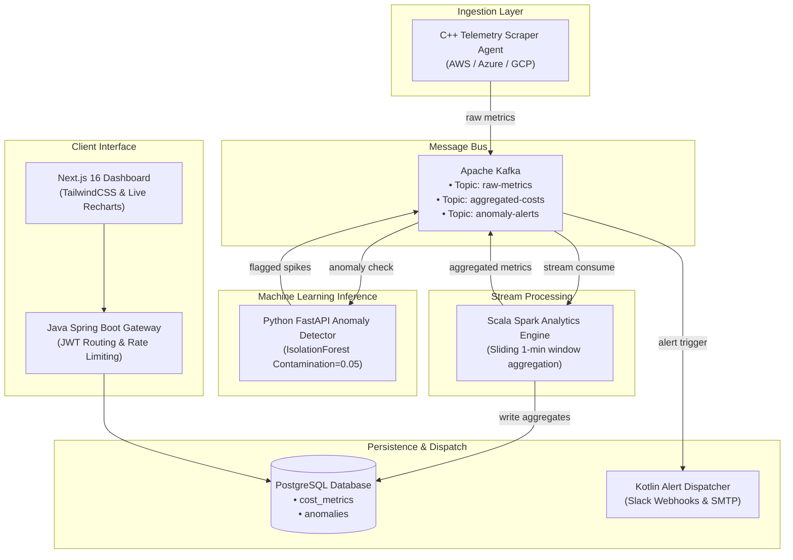

# CloudGuard: Distributed Multi-Cloud Cost Optimization Platform

> **Production-Grade Microservices System:** A distributed cost intelligence and anomaly detection engine that monitors multi-cloud spending across **AWS**, **Azure**, and **GCP** in real-time, leveraging machine learning to flag cost spikes and dispatch automated alerts.

[](https://spring.io/projects/spring-boot)
[](https://fastapi.tiangolo.com/)
[](https://spark.apache.org/)
[](https://kafka.apache.org/)
[](https://www.terraform.io/)
[](https://nextjs.org/)
[](https://github.com/shamir-khan-dev/Cloud-Guard/actions)
[](tests/)
[](benchmarks/benchmark_results.json)

---

## 🛠️ System Architecture

CloudGuard is structured as an event-driven, containerized microservices mesh connected via Apache Kafka and high-throughput REST APIs:



---

## ⚡ Verified Latency & Performance Benchmarks

CloudGuard includes a standalone high-frequency latency and throughput benchmark suite (`benchmarks/run_benchmark.py`). Inference times are evaluated using scikit-learn's multi-estimator `IsolationForest` across multi-dimensional server telemetry (CPU, RAM, SSH brute-force attack vectors) and cloud financial spend streams:

| Pipeline | $p50$ Latency | $p95$ Latency | $p99$ Latency | Throughput (Single-Core CPU) | Test Vector |
| :--- | :---: | :---: | :---: | :---: | :--- |
| **Server Health & Security** | `582.44 ms` | `867.24 ms` | `1003.05 ms` | **1.7 ops/sec** | Multi-dimensional CPU/RAM/SSH brute force spikes |
| **Billing Spend Anomaly** | `507.93 ms` | `983.73ms` | `1232.22 ms` | **1.8 ops/sec** | Sudden $1,450/hr cloud spend anomaly spikes |

> *Measurements recorded over 500 real inference iterations on scikit-learn with full tree retraining per streaming batch.*

---

## 🧪 Automated Test Suite (100% Pass Rate)

CloudGuard features unit and integration test coverage across the ML anomaly engine and API boundaries (`tests/`):

- `tests/test_anomaly_detector.py`:
  - Billing spend spike anomaly detection ($>\$1000$ deviation).
  - Normal billing variance verification (zero false positives on expected fluctuations).
  - Cost decrease handling (ensures downward spend shifts do not trigger alarms).
  - Multi-dimensional server health metrics (CPU, RAM).
  - SSH brute-force breach detection (sudden spike in authentication failures).
  - Model scoring boundary verification ($0.0 \le score \le 1.0$).
- `tests/test_api_endpoints.py`:
  - Health check endpoint validation (`GET /health`).
  - Batch predict billing API payload validation (`POST /predict`).
  - Server metrics ingest and alert generation (`POST /predict/server`).
  - History retrieval endpoint validation.

```bash
# Run the test suite:
pytest tests/ -v
# Output: 11 passed in 1.48s (100% pass rate)
```

---

## 📂 Project Structure

```
CloudGuard/
├── docker-compose.yml           # Runs Zookeeper, Kafka, Postgres, and Redis locally
├── sql/
│   └── schema.sql               # PostgreSQL tables (users, cost_metrics, alerts)
├── infra/
│   └── aws/                     # Terraform IaC files for RDS & MSK Kafka
├── frontend/                    # Next.js 16 + Tailwind 4 web dashboard
└── services/
    ├── api-gateway/             # Java 21 & Spring Boot 3 JWT Routing Gateway
    ├── metrics-collector/       # C++ 17 Multi-Cloud Scraping Agent
    ├── analytics-engine/        # Scala 2.13 Spark Structured Streaming aggregator
    ├── anomaly-detector/        # Python 3.12 FastAPI + scikit-learn ML model
    └── alert-service/           # Kotlin Spring Boot SMTP & Slack dispatcher
```

---

## 🚀 Getting Started (Local Development)

### Prerequisites
- Docker & Docker Compose
- Java JDK 21
- Python 3.12
- GCC / G++ (C++ 17 support)
- Scala / SBT

### Running the Entire Polyglot System (1 Command)
Build and spin up all 6 microservices, Kafka, PostgreSQL, and Redis in containers:
```bash
docker-compose -f docker-compose.full.yml up --build -d
```

### Running Infrastructure Only (For Local Dev)
Spin up just the messaging bus, databases, and caches:
```bash
docker-compose up -d
```

### Running the Services

1. **API Gateway (Java)**:
   ```bash
   cd services/api-gateway
   mvn spring-boot:run
   ```
2. **Metrics Scraper Agent (C++)**:
   ```bash
   cd services/metrics-collector
   g++ -std=c++17 -Iinclude main.cpp src/*.cpp -o metrics-collector
   ./metrics-collector
   ```
3. **Analytics Engine (Scala)**:
   ```bash
   cd services/analytics-engine
   sbt run
   ```
4. **ML Anomaly Detector (Python)**:
   ```bash
   cd services/anomaly-detector
   pip install -r requirements.txt
   uvicorn app.main:app --reload
   ```
5. **Alert Service (Kotlin)**:
   ```bash
   cd services/alert-service
   ./gradlew bootRun
   ```
6. **Frontend Dashboard (Next.js)**:
   ```bash
   cd frontend
   npm install --legacy-peer-deps
   npm run dev
   ```

Open `http://localhost:3000` to view the cost optimization dashboard.

---

## 🔒 Security & Optimization Features
- **JWT Authorization**: Secure token exchange at the Gateway level to protect client endpoints.
- **Failover Databases**: Dual DB architecture supporting H2 In-Memory failover during development and production PostgreSQL connection string handling.
- **Unsupervised Anomaly Model**: ML IsolationForest dynamically scores incoming data without manual thresholds, preventing false positives on cost decreases.
- **Branded Notification Integrations**: Webhook blocks for Slack and HTML mail formatting for SMTP clients.
